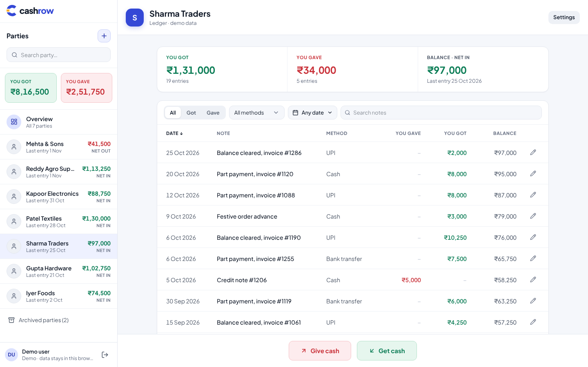
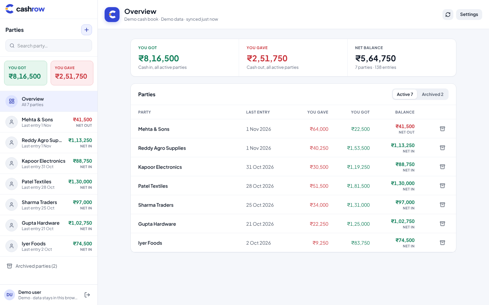
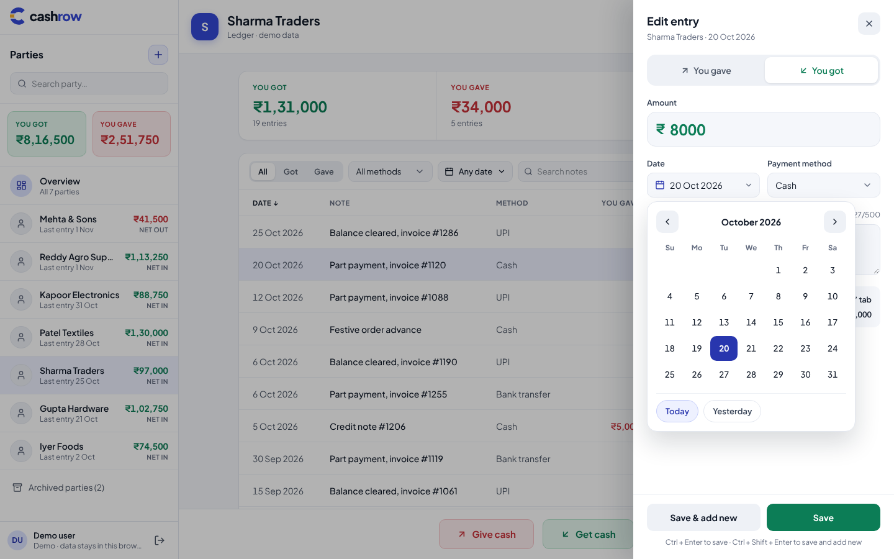
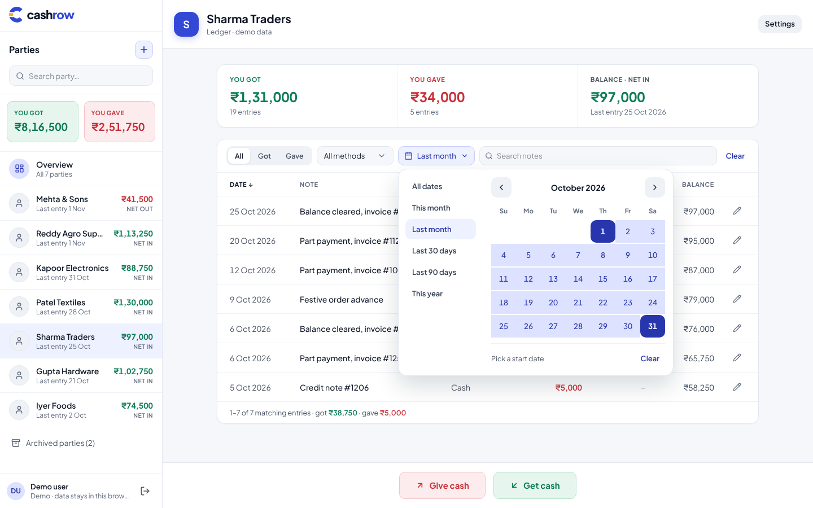
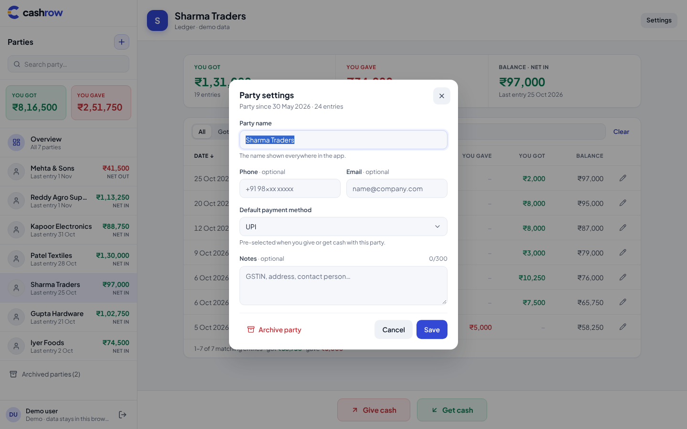
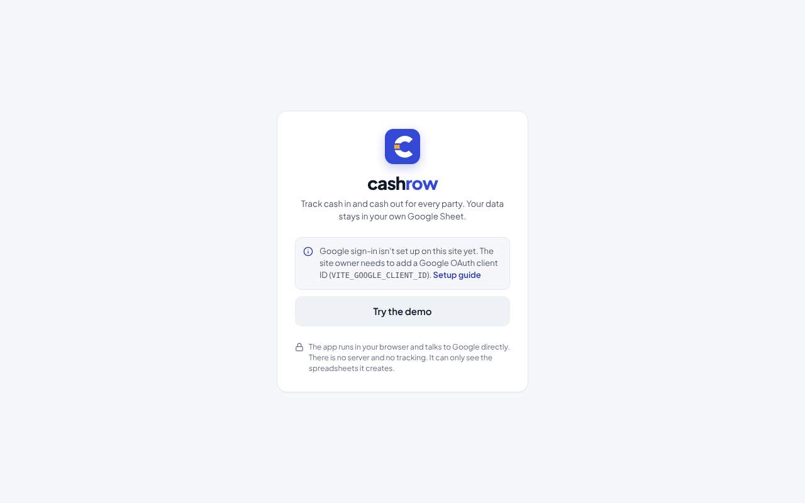
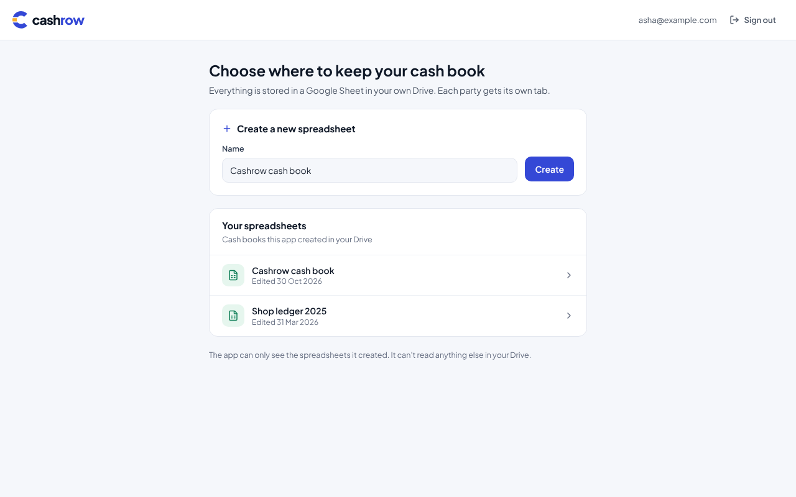

<p>
  <picture>
    <source media="(prefers-color-scheme: dark)" srcset="brand/svg/cashrow-logo-reversed.svg">
    
  </picture>
</p>

**Cash in, cash out. One row at a time.**

Cashrow is a free cash book for small businesses. Track cash in and cash out for every party you deal
with: customers, suppliers, anyone. Your data lives in **your own Google Sheet**, one tab per party, and
the app runs entirely in the browser. There is no server to run and no account to create. Fork it, add a
Google OAuth client ID, and deploy it anywhere static hosting works.



[](https://vercel.com/new/clone?repository-url=https%3A%2F%2Fgithub.com%2Fvulrun%2Fcashrow&env=VITE_GOOGLE_CLIENT_ID&envDescription=Google%20OAuth%20web%20client%20ID%20(see%20docs%2Fgoogle-cloud-setup.md)&project-name=cashrow)
[](https://app.netlify.com/start/deploy?repository=https://github.com/vulrun/cashrow)

> **Forking?** Replace `vulrun/cashrow` in this README and `REPO_URL` in `src/config/project.ts` with
> your own repository so the deploy buttons and the in-app setup link point at your copy.

## Features

- **Parties**: add, rename, archive and restore. Archiving hides the party's tab in Google Sheets;
  nothing is deleted.
- **Ledger per party**: date, note, payment method, you gave / you got, and a running balance.
- **Give cash / Get cash** side panel with **Save** (stay on the entry) and **Save & add new**
  (keeps date, type and method for fast entry). Keyboard: `Ctrl/⌘ + Enter`, `Ctrl/⌘ + Shift + Enter`.
- **Insights**: totals in, out and net balance per party and across all active parties.
- **Filters**: type, payment method, date range (presets or a custom range on a calendar), and note search.
- **Custom date pickers**: keyboard-friendly calendars, Today/Yesterday shortcuts, future dates blocked
  unless you allow them.
- **Settings as forms**: currency (₹, $, €, £ and more, with the right digit grouping), date format,
  payment methods, future-dated entries; per-party phone, email, default method and notes. Stored as
  JSON in the sheet, never shown as JSON in the app.
- **Safe with hand edits**: refetches when you come back to the tab, skips and reports unreadable rows,
  and refuses to overwrite a row that changed in Google Sheets.
- **Demo mode**: try everything with sample data, no Google account needed.
- Desktop and tablet first, works on phones. Accessible: labelled controls, keyboard support, focus states.

| Overview | Edit entry with date picker |
| --- | --- |
|  |  |
| **Date filter** | **Party settings** |
|  |  |
| **Sign in** | **Choose a cash book** |
|  |  |

Tablet ([820 px](docs/screenshots/tablet-ledger.png)) and phone ([390 px](docs/screenshots/phone-ledger.png)) layouts are in `docs/screenshots`.

## How it works

```
Browser (this app) ──OAuth token──▶ Google Sheets API / Drive API ──▶ Your spreadsheet
```

- Sign-in uses Google Identity Services with the `drive.file` scope: the app can only see the
  spreadsheets it created. No Google API key is needed.
- Each party is a tab. A `__Settings` tab holds app settings and the party list. Entries are rows:
  Date, Type (`IN`/`OUT`), Amount, Payment Method, Notes, plus hidden ID and timestamps.
  See [docs/data-model.md](docs/data-model.md).
- Google access tokens last about an hour. When one expires, a "Continue with Google" dialog gets a new
  one in a click, without losing anything you were typing.

## Try it locally

```bash
git clone https://github.com/vulrun/cashrow.git
cd cashrow
npm ci
npm run dev
```

Open <http://localhost:5173> and click **Try the demo**. To use your real Google account, create an
OAuth client ID ([docs/google-cloud-setup.md](docs/google-cloud-setup.md)), add
`http://localhost:5173` as an authorized JavaScript origin, then:

```bash
cp .env.example .env.local
# set VITE_GOOGLE_CLIENT_ID=... in .env.local
npm run dev
```

## Deploy your own

1. **Fork** this repository.
2. **Create a Google OAuth client ID** (about ten minutes, free): [docs/google-cloud-setup.md](docs/google-cloud-setup.md).
3. **Deploy** to any static host and set `VITE_GOOGLE_CLIENT_ID`:
   Vercel, Netlify, Cloudflare Pages, GitHub Pages (workflow included) or Docker.
   Step-by-step for each: [docs/deployment.md](docs/deployment.md).
4. **Add your site's origin** (for example `https://cashrow.example.com`) to the OAuth client's
   Authorized JavaScript origins.

### Configuration

| Variable | Required | Purpose |
| --- | --- | --- |
| `VITE_GOOGLE_CLIENT_ID` | for Google sign-in | OAuth web client ID |
| `VITE_ENABLE_DEMO` | no (default `true`) | Show "Try the demo" |
| `VITE_ROUTER_MODE` | no (default `browser`) | `hash` for hosts without SPA fallback |
| `VITE_BASE_PATH` | no (default `/`) | Serve from a sub-path |
| `VITE_APP_NAME` | no (default `Cashrow`) | Name in the header and tab |

All values are public (they ship in the bundle). The Docker image can also set them at run time.

That's the whole list: one OAuth client ID and nothing secret.

## Brand

The logo, app icons and colours live in [`brand/`](brand/README.md). Open
[`brand/brand-guide.html`](brand/brand-guide.html) in a browser for the visual guide: logo versions, the mark,
every colour with its hex code, contrast checks, icons and usage rules.

| Role | Colour | Hex |
| --- | --- | --- |
| Brand (logo, primary buttons, links) | Cobalt 600 | `#3448D6` |
| Hover, text on cobalt tints | Cobalt 700 | `#2836AE` |
| The newest row, highlights | Marigold 400 | `#F6AE2D` |
| Text, dark backgrounds | Ink 900 | `#0E1726` |
| App background | Mist | `#F5F7FB` |
| Cash in (You got) | Got 600 | `#0C7D56` |
| Cash out (You gave) | Gave 600 | `#C93139` |

The full palette (17 tokens) is in [`brand/tokens`](brand/tokens) as CSS variables, a Tailwind v4 theme
and JSON. In the app, colours are tokens in `src/index.css` and the mark is drawn by
`src/components/brand/Logo.tsx`. The typeface is Plus Jakarta Sans, bundled with the app.
For GitHub's link preview, upload `brand/social/cashrow-social-preview.png` under
**Settings > General > Social preview**.

## Development

| Command | What it does |
| --- | --- |
| `npm run dev` | Dev server with hot reload |
| `npm run check` | Lint, typecheck and unit tests (what CI runs) |
| `npm test` | Unit tests only |
| `npm run build` | Production build into `dist/` |

Stack: Vite, React 19, TypeScript, Tailwind CSS 4, shadcn-style components on Radix, Redux Toolkit with
RTK Query, React Router. Architecture and conventions: [docs/architecture.md](docs/architecture.md) and
[AGENTS.md](AGENTS.md) (also read by AI coding assistants; `CLAUDE.md` imports it).

## Documentation

| Doc | For |
| --- | --- |
| [docs/google-cloud-setup.md](docs/google-cloud-setup.md) | Creating the OAuth client ID |
| [docs/deployment.md](docs/deployment.md) | Vercel, Netlify, Cloudflare Pages, GitHub Pages, Docker, any static host |
| [docs/data-model.md](docs/data-model.md) | Exactly what the app writes to your spreadsheet |
| [docs/architecture.md](docs/architecture.md) | Layers, state, sign-in flow, error handling |
| [docs/security.md](docs/security.md) | Scopes, tokens, formula-injection protection, CSP |
| [AGENTS.md](AGENTS.md) | Rules and recipes for contributors and AI agents |
| [brand/README.md](brand/README.md) | Logo kit, colours and usage rules |

## FAQ

**Why no backend?** So anyone can run their own copy for free, and so your financial data only ever
sits in your Google account. The cost is a quick "Continue with Google" click roughly every hour.

**Can I edit the spreadsheet directly?** Yes. Add rows under the header (Date as `YYYY-MM-DD`, Type
`IN` or `OUT`, Amount), rename tabs, add your own tabs. The app picks up changes when you return to it.

**Can two people use the same cash book?** Not through the app. With the `drive.file` permission, the
app opens a spreadsheet only for the Google account that created it with Cashrow, so it never needs a
broader permission or an API key. You can still share the sheet in Google Sheets so others can view or
edit it there. The same account works on any number of devices.

**Does it support multiple currencies?** One currency per spreadsheet, set in Settings. Use separate
spreadsheets for separate currencies.

**Is it free?** The app is MIT-licensed. Google Sheets and the APIs used here are free at normal usage.

## Contributing

Issues and pull requests are welcome. See [CONTRIBUTING.md](CONTRIBUTING.md).

## License

[MIT](LICENSE)
