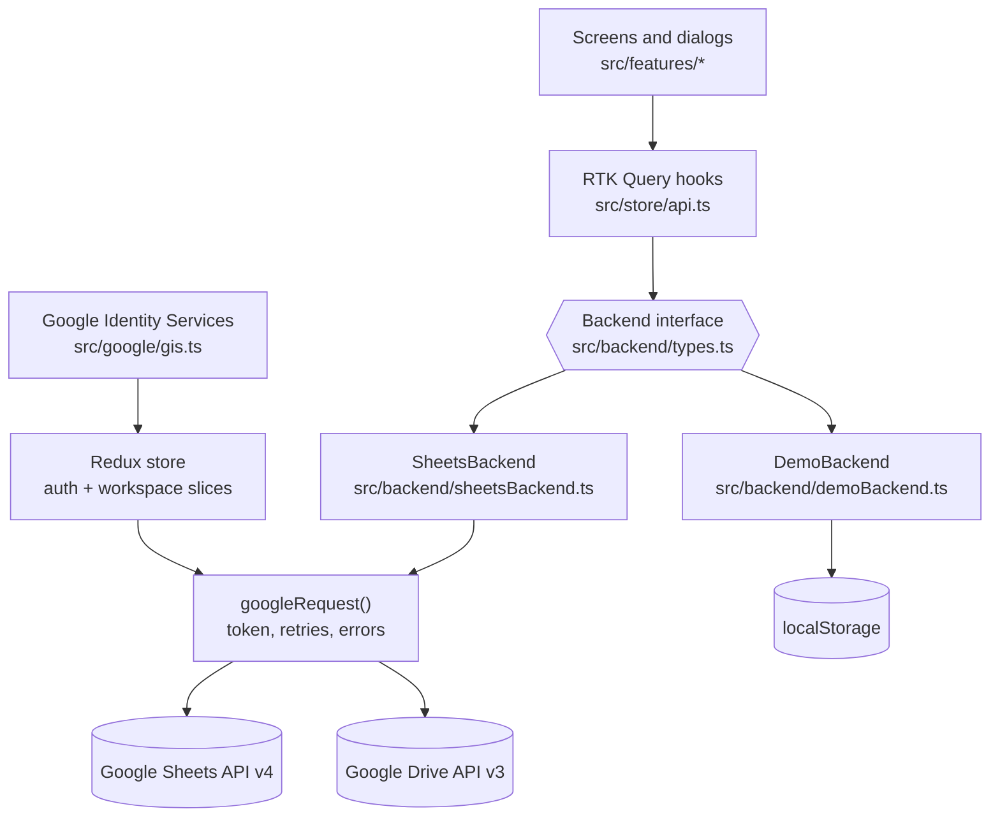
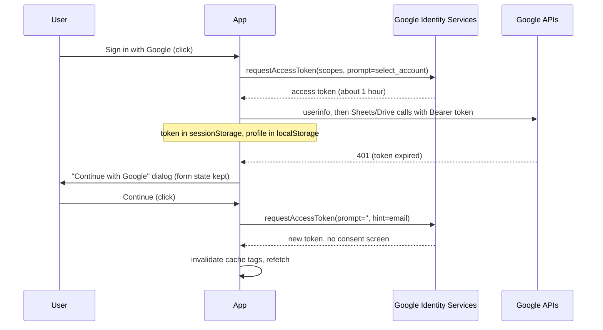

# Architecture

Cashrow is a static single-page app. The browser talks to Google directly; there is no
server of our own. This page explains how the pieces fit together.

## Layers

- **Screens** (`src/features`) read data through RTK Query hooks and never import Google modules.
- **`store/api.ts`** defines every query and mutation. Each one calls the active `Backend`, turns errors
  into plain `AppError` objects, and updates the cache.
- **`Backend`** is the single storage interface. `SheetsBackend` is the real one; `DemoBackend` keeps
  sample data in `localStorage` so anyone can try the app (and develop the UI) without Google.
- **`google/`** holds thin REST clients. `http.ts` adds the access token, retries rate limits and
  5xx responses with backoff, and maps failures to `ApiError` kinds.

## State

| Slice | Holds | Persisted |
| --- | --- | --- |
| `auth` | mode (`google` or `demo`), user, access token, expiry, status | user and mode in `localStorage`; token in `sessionStorage` |
| `workspace` | selected spreadsheet id, owner email | `localStorage` |
| `api` (RTK Query) | spreadsheets list, workspace, ledgers | memory only, refetched on focus and reconnect |

Derived numbers (totals, running balances, filtered lists) are computed with memoised selectors in
`features/cashbook/useCashbook.ts` and `domain/ledger.ts`; they are never stored.

### Queries

| Endpoint | Google calls | Cache tag |
| --- | --- | --- |
| `listSpreadsheets` | Drive `files.list` (app-tagged sheets) | `Spreadsheets` |
| `getWorkspace(id)` | `spreadsheets.get` + one `values:batchGet` | `Workspace` |
| `getLedgers(id)` | one `values:batchGet` for all party tabs (chunks of 40) | `Ledgers` |

### Mutations

| Endpoint | Google calls | Cache update |
| --- | --- | --- |
| `createSpreadsheet` | `spreadsheets.create`, Drive `files.update` (tag) | invalidates `Spreadsheets` |
| `initializeSpreadsheet` | `batchUpdate` (re-adds a deleted `__Settings` tab) | invalidates `Workspace` |
| `addParty` | one atomic `batchUpdate` (tab + headers + registry row) | inserts party, then refetches workspace |
| `updateParty` | one `batchUpdate` (rename tab, A1 JSON, registry row) | replaces party |
| `setPartyArchived` | one `batchUpdate` (hide/unhide tab, registry row) | replaces party |
| `addEntry` | `values:append` (RAW) | appends entry to the cached ledger |
| `updateEntry` | `values.get` (check) + `values.update` (RAW) | replaces entry; on conflict refetches ledgers |
| `saveSettings` | `values.update` on `__Settings!A1` | replaces settings |

A typical session costs a handful of requests: two to open a spreadsheet, one to load all ledgers, one
or two per save. That is far below the Sheets API's per-user quota.

## Sign-in and sessions

- The GIS token model gives the browser a short-lived token with no refresh token. That keeps the app
  backend-free; the trade-off is a one-click re-auth about every hour.
- Scopes: `openid email profile https://www.googleapis.com/auth/drive.file`. `drive.file` is
  non-sensitive and only covers files the app created.
- If the user unticks the Drive permission on the consent screen, sign-in fails with a clear message
  (`hasGrantedAllScopes` check in `gis.ts`).
- Signing in with a different Google account clears the remembered spreadsheet.

## Routing

| Path | Screen | Guard |
| --- | --- | --- |
| `/` (signed out) | Landing page; its buttons go to `/login` | none |
| `/login` | Sign in or try the demo | none |
| `/privacy`, `/terms` | Privacy policy and terms of service | none |
| `/setup` | Create a spreadsheet, pick one, or open from Drive | signed in |
| `/` | Overview: totals and all parties (`?view=archived` for archived) | signed in + spreadsheet chosen |
| `/parties/:partyId` | One party's ledger, entry panel, party settings | signed in + spreadsheet chosen |

`RequireAuth` decides what `/` shows: the landing page for signed-out visitors, the overview once signed in,
so bookmarks to `/` keep working. Every other guarded path sends signed-out visitors to `/login`.

`VITE_ROUTER_MODE=hash` switches to hash URLs (`/#/parties/...`) for hosts without an SPA fallback.

## Errors

`google/errors.ts` turns every failure into an `ApiError` with a `kind`:

| Kind | Typical cause | What the user sees |
| --- | --- | --- |
| `auth` | token expired or revoked | "Continue with Google" dialog |
| `permission` | file not shared with this account | message + "Choose another spreadsheet" |
| `notFound` | spreadsheet or tab deleted/renamed | message + "Choose another spreadsheet" |
| `notInitialized` | picked a spreadsheet without `__Settings` | "Set it up" button |
| `quota` | rate limited (429 / rate-limit 403) | retried automatically, then a toast |
| `server` / `network` | Google 5xx, offline | retried (reads only), then a toast with Try again |
| `conflict` | row changed in the sheet since load | message, ledger reloads |
| `invalid` | Google rejected the request | Google's message |

Writes that are not idempotent (append, batchUpdate) are only retried on rate limits, where Google
guarantees nothing was written, so a flaky network can't create duplicate entries.

## Editing the sheet by hand

People will edit the spreadsheet directly, so the app is defensive:

- Workspace and ledgers refetch when the window regains focus.
- Rows without an ID (typed by hand) are read with a synthetic `row-N` id and get a real ID the first
  time they are edited in the app.
- Unreadable rows (bad date, unknown type, non-numeric amount) are skipped and listed in a warning on
  the party page.
- Before an update, the row is re-read; if its ID or `Updated At` changed, the save is refused with a
  `conflict` error instead of overwriting someone else's change.
- Renaming a tab in Google Sheets is fine: parties are matched by tab id, and the tab title becomes the
  party name.

## Demo mode

`DemoBackend` implements the same interface over `localStorage`, seeded from `backend/demoSeed.ts`
(dates are shifted so the newest entry is always yesterday). It powers **Try the demo** and is the
quickest way to develop UI. Turn it off for a deployment with `VITE_ENABLE_DEMO=false`.
